# Hardening de red con Cisco, FortiGate y Python

## 🎥 Video demostrativo

**[▶ Ver la práctica de hardening en YouTube](https://youtu.be/PTBqgQA67To)**

Demostración del router, switch y firewall implementados en GNS3, de los controles de seguridad seleccionados y de la automatización mediante Python y Netmiko.

**[📄 Consultar la documentación completa en PDF (25 páginas)](Documentacion_Hardening_CIS_Oliver_Eliam_Aquino_Paulino.pdf)**

**Estudiante:** Oliver Eliam Aquino Paulino  
**Matrícula:** 2024-1571  
**Asignatura:** Seguridad de Redes  
**Fecha:** 13 de noviembre de 2026  
**Herramientas:** GNS3 · Cisco 7200 · Cisco IOSvL2 · FortiGate 7.0.9 · Windows 11 · Python · Netmiko

## Descripción del proyecto

Esta práctica implementa una topología formada por **un router Cisco R1, un switch Cisco SW1 y un firewall FortiGate**. Un script de Python realiza auditorías de seguridad sobre la configuración administrativa de los tres equipos, permite generar informes sin alterar la red y ofrece un segundo modo para respaldar las configuraciones, aplicar ajustes y volver a comprobarlos.

Los controles se seleccionaron tomando como referencia buenas prácticas de endurecimiento asociadas a los CIS Benchmarks de Cisco y Fortinet. La herramienta **no es un analizador CIS oficial** ni evalúa todos los controles del benchmark.

## Resultado demostrado

| Equipo | Auditoría inicial | Auditoría posterior |
|---|---:|---:|
| Router R1 | 4/5 | 5/5 |
| Switch SW1 | 2/5 | 5/5 |
| FortiGate | 2/5 | 5/5 |
| **Total** | **8/15** | **15/15** |

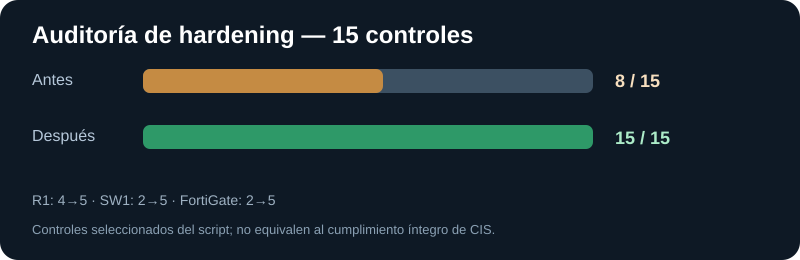

*Figura 1. Evolución de la auditoría automática de los tres dispositivos.*

Las mediciones corresponden a los **15 controles programados**. Entre las siete diferencias encontradas, **seis fueron corregidas con cambios de configuración** y una se resolvió ajustando la comprobación de TLS del script para reconocer TLS 1.2 como válido.

## Topología GNS3

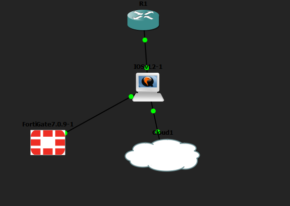

*Figura 1. Captura original con R1, SW1, FortiGate y Cloud1.*

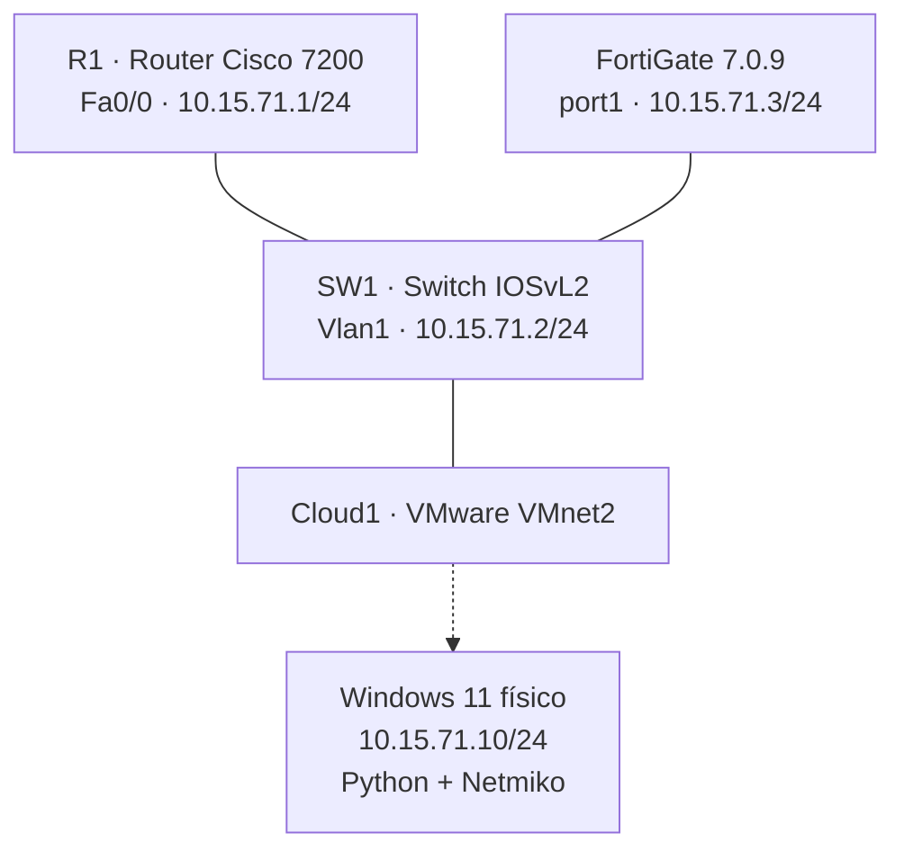

El switch actúa como punto central de la LAN de administración. Cloud1 conecta los dispositivos de GNS3 con el Windows 11 físico, donde se ejecuta el script. El firewall es uno de los dispositivos **auditados**, no un paso de tránsito obligatorio entre R1 y Windows.

### Direccionamiento

| Dispositivo | Interfaz | IPv4 | Función |
|---|---|---|---|
| R1 | FastEthernet0/0 | `10.15.71.1/24` | Router y acceso administrativo |
| SW1 | Vlan1 | `10.15.71.2/24` | Switching y acceso administrativo |
| FortiGate | port1 | `10.15.71.3/24` | Administración HTTPS/SSH |
| Windows 11 | VMware VMnet2 | `10.15.71.10/24` | Host de automatización |

### Comprobación visual: antes y después

**Auditoría inicial — 8 de 15 controles conformes:**

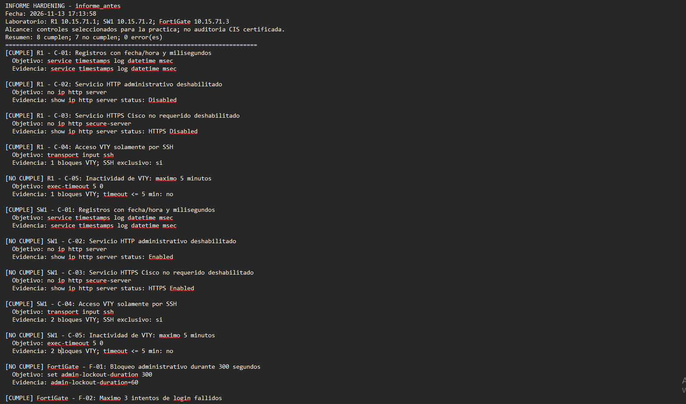

**Auditoría final — 15 de 15 controles conformes:**

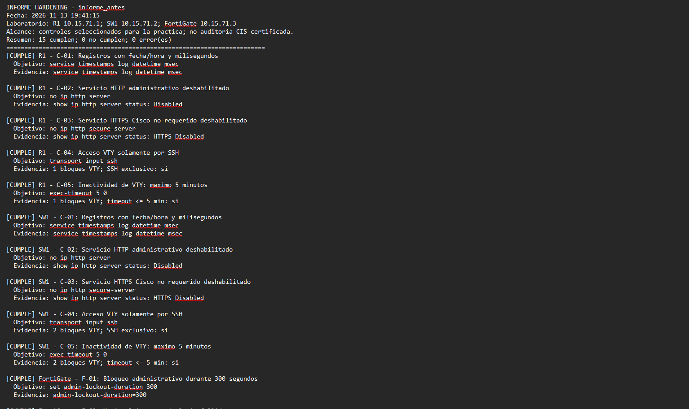

## Controles de hardening

### Router R1 y Switch SW1

| Regla | Configuración deseada | Finalidad |
|---|---|---|
| C-01 | `service timestamps log datetime msec` | Registros con fecha y hora |
| C-02 | `no ip http server` | Deshabilitar HTTP administrativo innecesario |
| C-03 | `no ip http secure-server` | Deshabilitar HTTPS Cisco no utilizado |
| C-04 | `transport input ssh` | Administración VTY solo mediante SSH |
| C-05 | `exec-timeout 5 0` | Cierre automático tras 5 min de inactividad |

### Firewall FortiGate

| Regla | Configuración deseada | Finalidad |
|---|---|---|
| F-01 | `admin-lockout-duration 300` | Bloqueo tras fallos de acceso |
| F-02 | `admin-lockout-threshold 3` | Máximo de 3 intentos fallidos |
| F-03 | `admin-ssh-grace-time 30` | Limitar tiempo de autenticación SSH |
| F-04 | `admin-https-ssl-versions tlsv1-2` | No permitir TLS inferior a 1.2 en la GUI |
| F-05 | `admin-ssh-v1 disable` | Deshabilitar SSHv1 |

`C-01` y `F-01` son **códigos internos del script**, no identificadores oficiales de CIS. Las justificaciones y pruebas de cada uno están desarrolladas en el [informe técnico](docs/Informe_tecnico_Hardening.md).

### Pruebas directas sobre los dispositivos

**Router R1 — administración HTTP/HTTPS, VTY y SSH:**

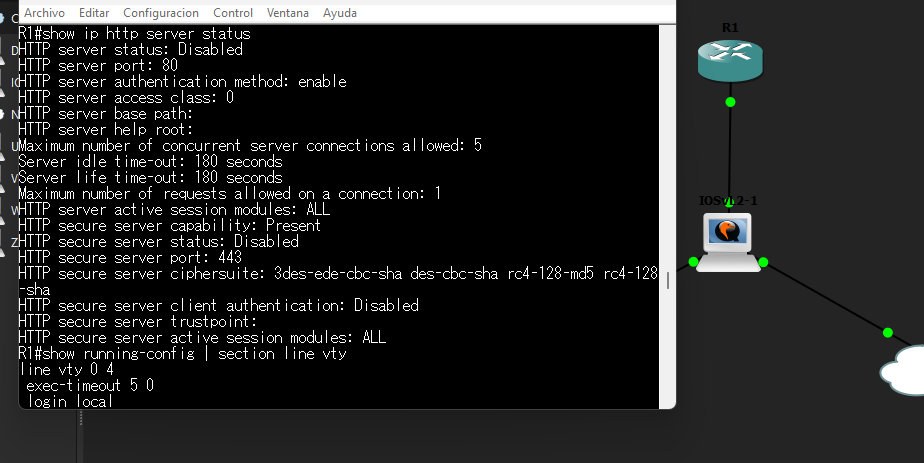

**Switch SW1 — acceso administrativo y registro de eventos:**

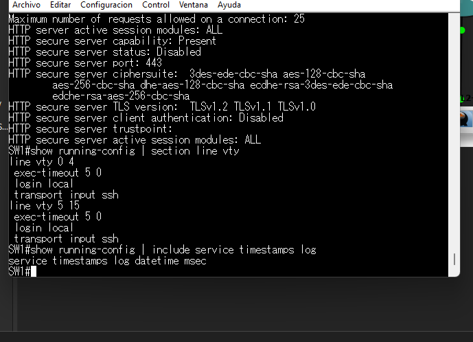

**FortiGate — bloqueo administrativo, SSH y TLS:**

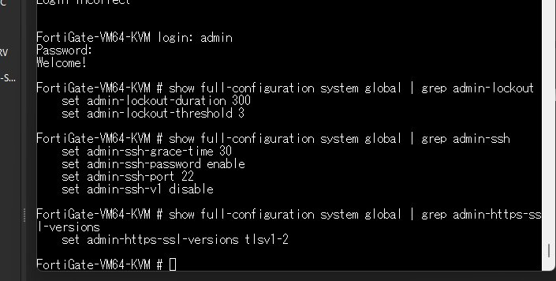

## Script de auditoría y remediación

**[Ver código Python completo](scripts/hardening_cis.py)**

Ejecutar en PowerShell desde la carpeta del proyecto:

```powershell
py -m pip install "netmiko[par4]"
py .\scripts\hardening_cis.py
```

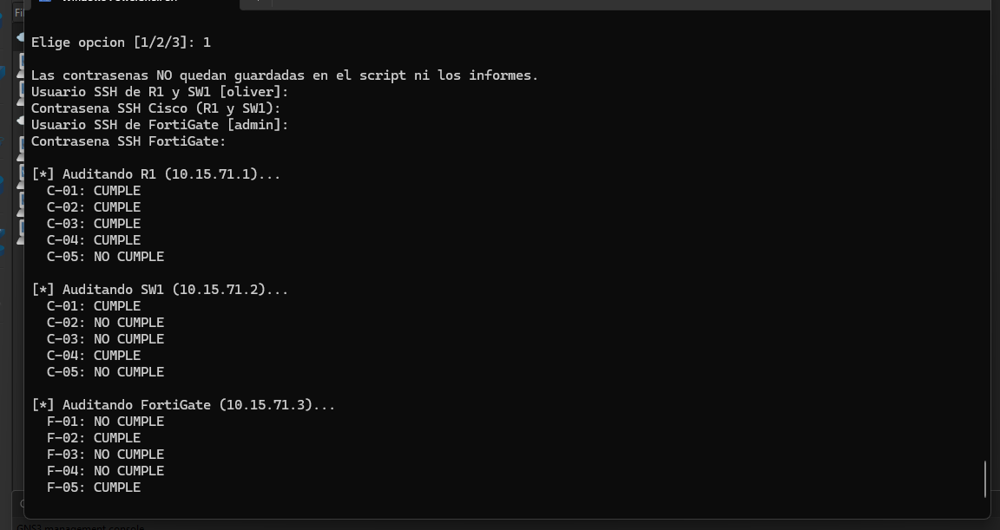

*Figura 2. Menú de la herramienta en PowerShell.*

El programa ofrece:

1. **SOLO AUDITAR:** consulta R1, SW1 y FortiGate; genera informe sin cambiar configuraciones.
2. **RESPALDAR + AUDITAR + APLICAR + INFORME POSTERIOR:** crea respaldo, solicita confirmación, aplica controles pendientes y ejecuta una verificación posterior.

Las contraseñas se introducen durante la ejecución y no aparecen incrustadas en el código. La compatibilidad `par4` se utiliza en el laboratorio para comunicarse con las implementaciones SSH antiguas de Cisco.

### Ejecución de la opción 2

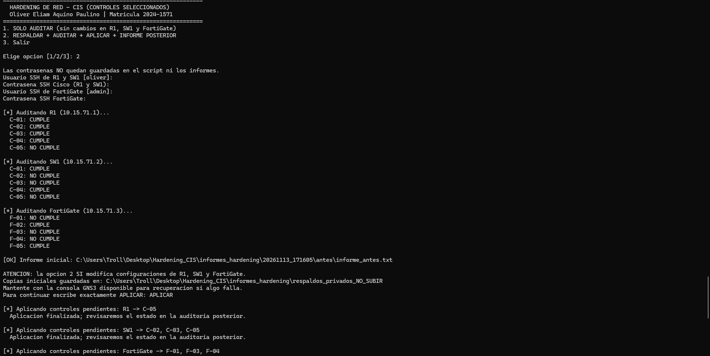

*La captura muestra la ejecución original de las correcciones. La incidencia posterior de TLS se documenta como parte de las pruebas y se solucionó antes de la auditoría final.*

## Evidencias de la práctica

**[Informe inicial — 8 cumplen, 7 pendientes](informes/01_Auditoria_inicial_8_de_15_RECONSTRUIDA.txt)**  
**[Informe final — 15 cumplen, 0 pendientes, 0 errores](informes/02_Auditoria_final_15_de_15.txt)**

El primero es una transcripción documentada a partir de la salida inicial del programa. El segundo conserva la salida del TXT final recibido, incluida su hora de ejecución.

**Pruebas directas:** `show ip http server status`, `show running-config | section line vty`, `show running-config | include service timestamps log` y `show full-configuration system global | grep admin-`.

### Galería complementaria de capturas originales

<details>
<summary>Mostrar pruebas adicionales de R1, SW1 y el ajuste de TLS</summary>

**Continuación de las pruebas de R1**

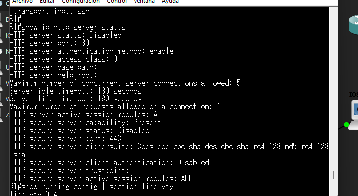

**Servicio HTTP/HTTPS de SW1**

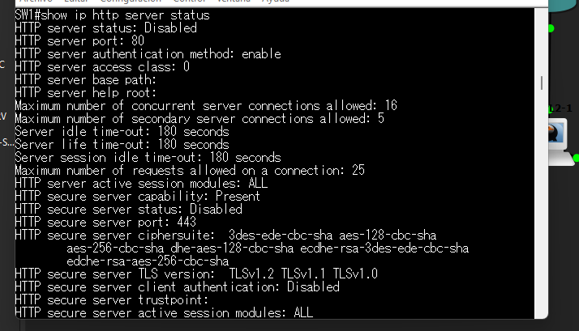

**Incidencia intermedia de TLS en FortiGate**

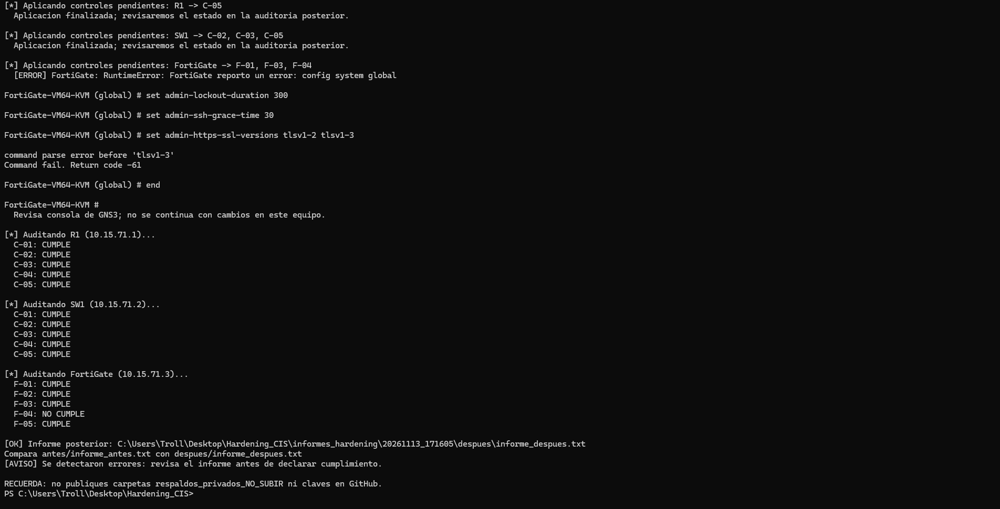

</details>

## Configuraciones completas y anexos

**[📄 PDF técnico con anexos completos de R1, SW1 y sección global de FortiGate](Documentacion_Hardening_CIS_Oliver_Eliam_Aquino_Paulino.pdf)**


- [R1 — running-config completo, copia literal recibida](running-configs/R1_running-config_COMPLETO.txt)
- [SW1 — running-config completo, copia literal recibida](running-configs/SW1_running-config_COMPLETO.txt)
- [FortiGate — sección system global completa](running-configs/FortiGate_system_global_FULL.txt)
- [FortiGate — configuración observada de interfaces](running-configs/FortiGate_system_interface.txt)
- [Informe técnico: recomendaciones, justificaciones y resultados](docs/Informe_tecnico_Hardening.md)
- [Comandos usados para verificar cada equipo](docs/Comandos_de_verificacion.md)
- [Registro de evidencias y resultados](docs/Registro_de_evidencias.md)
- [Video de la demostración](https://youtu.be/PTBqgQA67To)

**Nota sobre integridad:** R1 y SW1 son transcripciones completas de `show running-config` y conservan todas las líneas que entregaste, incluidos los hashes de autenticación. Como el repositorio es público, se recomienda cambiar esas credenciales del laboratorio. La configuración completa del apartado `system global` de FortiGate **no equivale** a un `show full-configuration` de todo el equipo; se aportan las secciones obtenidas en el laboratorio. 

## Conclusión

Se verificó la conexión y la auditoría de R1, SW1 y FortiGate desde Windows mediante SSH y Netmiko. La herramienta identificó configuraciones pendientes, aplicó las correcciones seleccionadas y produjo informes que documentan el cambio de **8/15 a 15/15** controles evaluados.